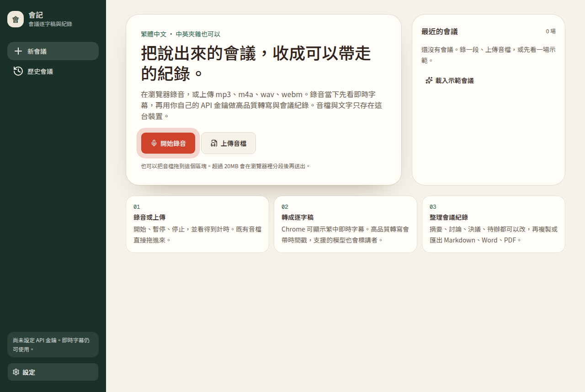
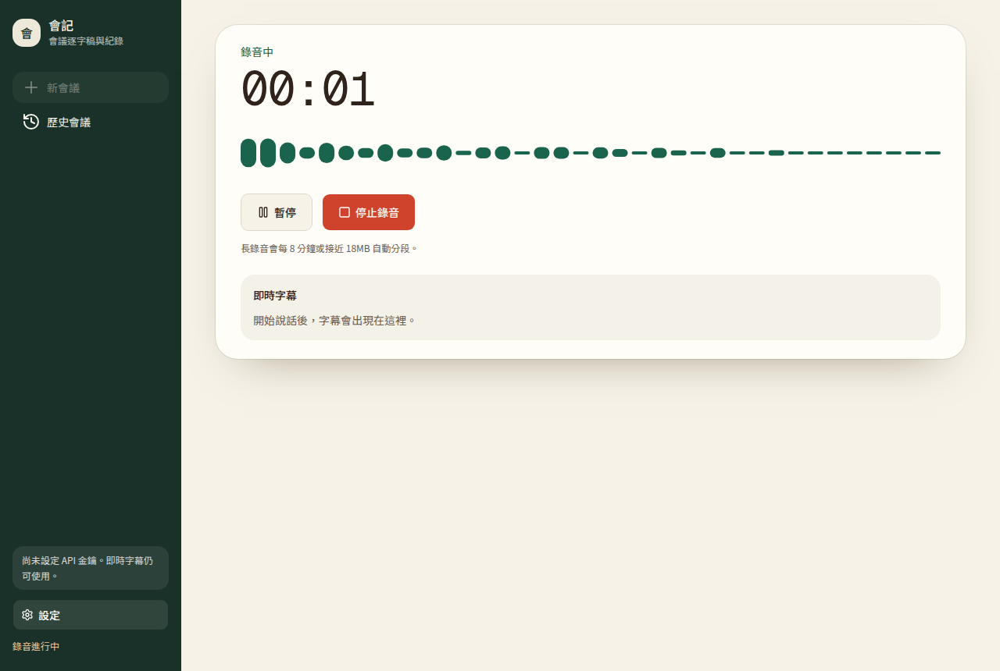
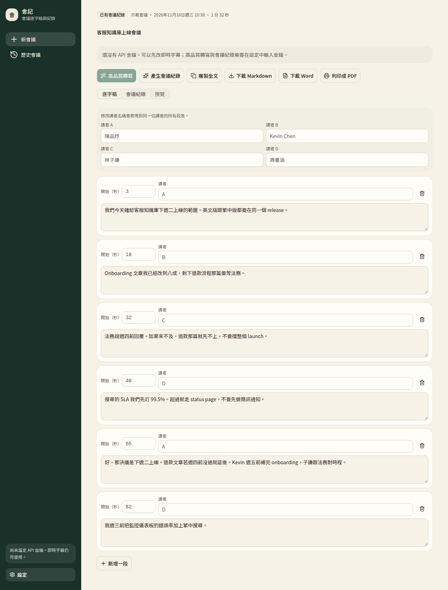
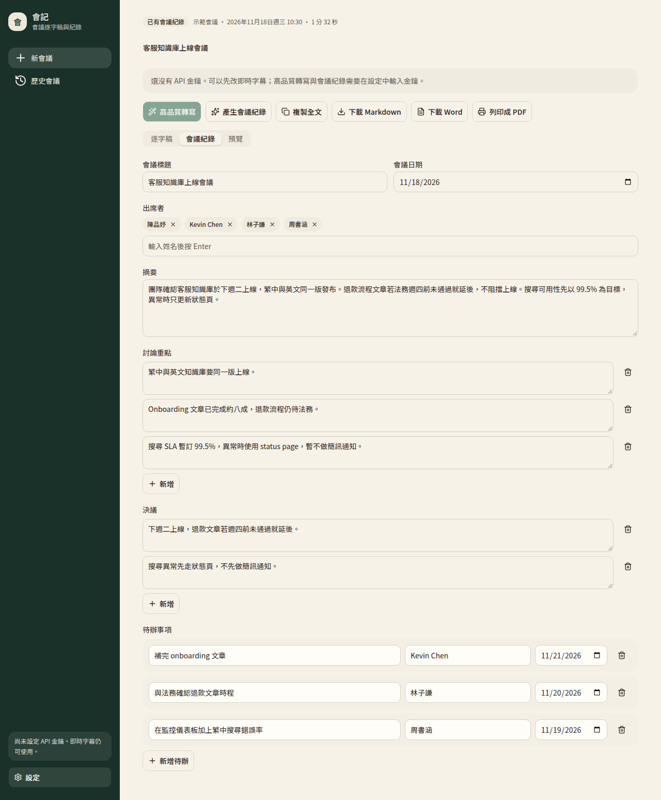
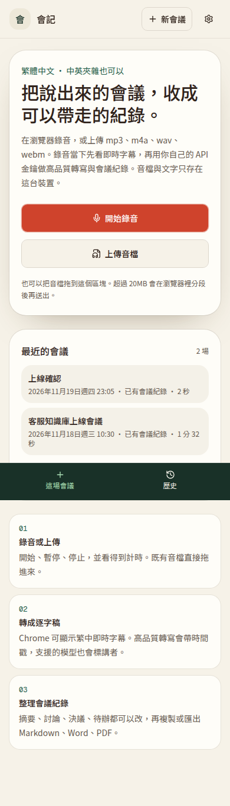

# 會記

會記是給繁體中文會議用的逐字稿與會議紀錄工具。在瀏覽器裡錄音或上傳音檔，先看即時字幕，再用你自己的 OpenAI API 金鑰做高品質轉寫，整理成可編輯的會議紀錄，並匯出 Markdown、Word 或 PDF。

介面全部是繁體中文，也聽得懂中英夾雜。音檔、逐字稿、會議紀錄與 API 金鑰都只留在這台瀏覽器，專案裡沒有後端密鑰。



## 功能

- 瀏覽器錄音：開始、暫停、繼續、停止，以及計時。長錄音會每 8 分鐘或接近 18MB 自動分段，避免超過語音 API 的單檔大小。
- 上傳既有音檔：mp3、m4a、wav、webm。超過 20MB 時，瀏覽器會解碼成 16kHz 單聲道 WAV 再分段上傳。
- 即時字幕：支援的瀏覽器（主要是 Chrome、Edge）使用 Web Speech API，語言為 `zh-TW`。這是免費的初步稿，標點與專有名詞可能不準。
- 高品質轉寫：把音檔送到 OpenAI 相容的 `/audio/transcriptions`。可選 `gpt-4o-mini-transcribe`、`gpt-4o-transcribe`、`gpt-4o-transcribe-diarize`（講者）或 `whisper-1`（時間戳）。保留時間戳；模型有回傳講者時會顯示，並可把「講者 A」改成真實姓名。
- 會議紀錄：用同一個金鑰呼叫聊天模型，產生標題、日期、出席者、摘要、討論重點、決議、待辦（負責人與期限）。沒有出現在逐字稿裡的內容不會被要求臆測。輸出為繁體中文。
- 逐字稿與會議紀錄都可以直接修改。
- 匯出：複製 Markdown、下載 `.md`、下載 `.docx`，或用瀏覽器列印存成 PDF。
- 歷史會議存在 IndexedDB，可重新打開或刪除。

## 環境

- Node.js 20 或更新版本
- 現代瀏覽器。錄音需要 localhost 或 HTTPS。
- 高品質轉寫與會議紀錄需要你自己的 [OpenAI API 金鑰](https://platform.openai.com/api-keys)。即時字幕不需要金鑰。

## 在本機執行

```bash
npm install
npm run dev
```

打開 [http://localhost:3000](http://localhost:3000)。

其他指令：

```bash
npm test        # 單元測試，使用模擬的轉寫與會議紀錄 API
npm run lint
npm run build
npm start       # 執行建置後的正式版
```

## 設定 API 金鑰

1. 按側欄或手機上的「設定」。
2. 貼上 OpenAI API 金鑰。它只寫進這個瀏覽器的 `localStorage`（鍵名 `huiji.settings.v1`），不會進 Git，也不會寫進伺服器資料庫。
3. 「API 基底網址」留白即使用 `https://api.openai.com/v1`。若要改用相容服務，填它的 HTTPS 根網址（需要能接受 `/audio/transcriptions` 與 `/chat/completions`）。金鑰會送到這個網址，請只填你信任的服務。不接受本機或私有網段。
4. 轉寫模型與會議紀錄模型可以改，也可以直接輸入新的模型名稱。
5. 按「測試連線」確認金鑰可用。

瀏覽器不能直接呼叫 OpenAI（跨域限制），所以這個網站會把請求轉送出去。轉送時讀取你當次請求裡的金鑰，放進上游的 `Authorization` 標頭，不會把金鑰寫進紀錄、檔案或環境變數。請不要把金鑰放進 `.env`。


## 怎麼用

1. 按「開始錄音」，允許麥克風。錄音中可以暫停。Chrome 會盡量顯示繁中即時字幕。
2. 或按「上傳音檔」，也可以把檔案拖進首頁。
3. 停止或上傳完成後，按「高品質轉寫」。沒有金鑰時會提示你先到設定填寫。
4. 修改逐字稿與講者名稱，再按「產生會議紀錄」。
5. 在會議紀錄裡改摘要、決議與待辦，然後複製或下載。
6. 左側「歷史會議」可以找回先前的內容。想先看版面，按「載入示範會議」。







## 長錄音與檔案大小

OpenAI 轉寫單檔上限是 25MB。會記把每一段控制在約 20MB 以內：

- 錄音：每 8 分鐘，或累積接近 18MB，就切成一個新的音檔再繼續。
- 上傳：小於 20MB 的檔案原檔送出。更大的檔案會在瀏覽器裡解碼，轉成 16kHz 單聲道 WAV，每 8 分鐘一段。非常長的檔案需要較多記憶體；超過 200MB 會請你先剪短。若瀏覽器解碼不了，請先轉成較小的 mp3 或 wav。

分段後的時間戳會接回整段會議的時間。

## 隱私

| 資料 | 放在哪裡 |
| --- | --- |
| API 金鑰、模型名稱 | 瀏覽器 `localStorage` |
| 會議、逐字稿、會議紀錄、音檔 | 瀏覽器 IndexedDB |
| 轉送中的金鑰 | 只存在該次請求的記憶體，用完即丟 |

清除方式：設定裡的「清除設定」會刪除金鑰；歷史會議裡的垃圾桶會刪除該場的文字與音檔。

## 部署

不需要設定任何環境變數。

**Vercel**

1. 把這個專案推到 Git 平台並匯入 Vercel。
2. 框架選 Next.js，建置指令維持 `npm run build`。
3. 不要新增 `OPENAI_API_KEY` 這類變數。使用者在網站裡自己貼金鑰。

**一般 Node 主機**

```bash
npm install
npm run build
npm start
```

正式環境請用 HTTPS，瀏覽器才會開放麥克風。`localhost` 在開發時例外。

## 瀏覽器

| 能力 | Chrome / Edge | Safari | Firefox |
| --- | --- | --- | --- |
| 錄音、上傳、匯出、歷史 | 可以 | 可以 | 可以 |
| 繁中即時字幕 | 可以 | 不穩定或沒有 | 通常沒有 |

沒有即時字幕時仍可錄音，結束後用 API 轉寫。

## 測試

`npm test` 使用 Vitest，不需要真的金鑰。測試會：

- 用程式產生的 WAV 樣本呼叫轉寫流程，並確認分段時間戳接得起來。
- 模擬聊天 API，確認會議紀錄 JSON 能變成標題、決議與待辦。
- 確認缺少金鑰時不會送出請求，401 會變成繁體中文說明。
- 確認轉送層拒絕私有網址與重新導向，而且回應裡不會出現金鑰。
- 確認示範會議可以匯出 Markdown 與 Word。


